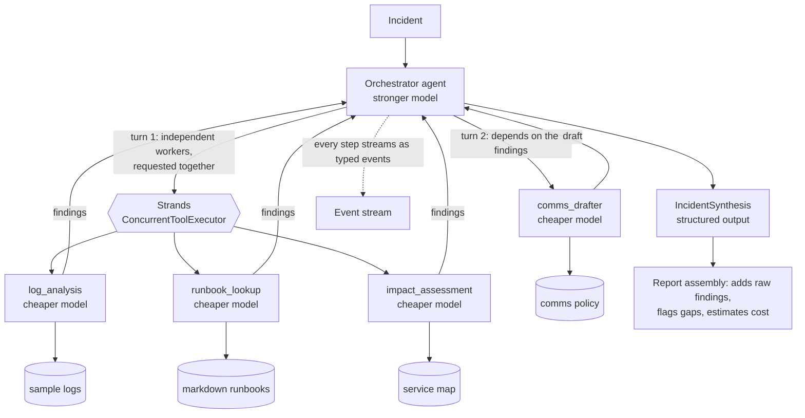
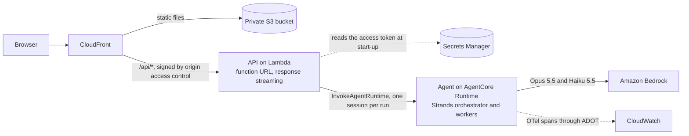

# Orchestrator-workers incident response with Strands Agents

A public proof of concept showing **one framework** ([Strands Agents](https://strandsagents.com))
implementing **one agentic pattern** (orchestrator-workers) for **one enterprise job**: IT operations
incident response.

An incident goes to an orchestrator agent on a stronger model. It decides, at run time, which
specialist workers on a cheaper model to call. They run in parallel where they are independent, and
the orchestrator turns their findings into an incident summary, probable cause, recommended actions
and a stakeholder message.

> **Status.** Everything has been tested offline, with a fake LLM and a stubbed AWS client, and the
> container images have been run locally against the AgentCore contract. **It has never run against
> live Bedrock and the infrastructure has never been deployed**, because no AWS credentials were
> available when it was built. Expect the first real deployment to find something. See
> [Limitations](#limitations).

## Try it

You need [uv](https://docs.astral.sh/uv/) and Node.js 22 or later, but no AWS account.

```bash
make install
make dev        # open http://localhost:5173
```

Submit an incident and watch the orchestrator's plan and each worker's progress as they stream, then
read the report with its per-worker traces and token and cost estimate. Try several samples to see
the team change, and simulate a worker failure to see the run degrade. Set `API_PORT` or `WEB_PORT`
if those ports are taken.

Without the UI:

```bash
make sample                               # the full team on a sev1 outage
make sample SAMPLE=batch-disk-full        # the same code picks a smaller team
uv run python -m incident_agent --list    # all the samples
uv run python -m incident_agent --sample batch-disk-full --simulate-failure log_analysis
```

The fake LLM is keyword rules and templates, so its prose is not impressive and its "judgement" is
not judgement. What it shows is everything around the model: the Strands event loop, parallel
execution, and real tool calls over the bundled sample data all run for real.

For real models, enable access to the models in your account, then:

```bash
LLM_MODE=bedrock AWS_REGION=us-east-1 make dev
```

| Variable | Default | Purpose |
| --- | --- | --- |
| `LLM_MODE` | `fake` | `fake` or `bedrock` |
| `BEDROCK_MODEL_ID` | `us.anthropic.claude-opus-5-5` | Orchestrator model |
| `BEDROCK_WORKER_MODEL_ID` | `us.anthropic.claude-haiku-5-5` | Worker model |
| `AWS_REGION` | `us-east-1` | Region for Bedrock calls |

See [`.env.example`](.env.example) for the rest. The defaults are geo inference profile ids from the
[Bedrock model cards](https://docs.aws.amazon.com/bedrock/latest/userguide/model-cards.html). If you
use `aws login` credentials, botocore also needs `botocore[crt]`.

## The pattern

In **orchestrator-workers**, a central LLM breaks down a task it cannot plan in advance, hands the
pieces to workers, and combines what comes back. The defining feature is that **the subtasks are
decided at run time, from the input**.

**Use it when** the work splits into specialisms, which ones you need depends on the input, and some
can run independently. Incident response fits: a full disk does not need a customer announcement, and
planned maintenance does not need log forensics.

**Do not use it when:**

- The steps are the same every time. A pipeline is cheaper, faster and easier to test.
- A single agent with several tools would do. Workers earn their keep through isolated context and a
  cheaper model, and if you do not need those, they are only extra latency.
- Workers must negotiate with each other. Here they only ever talk to the orchestrator.
- Being wrong is expensive and hard to catch. Here the LLM chooses the work, so runs vary. This
  project only ever recommends actions to people, and nothing it does changes a system.



## How Strands expresses it

**This project uses agents-as-tools**, because that is the Strands primitive with the same shape as
the pattern:

```python
# src/incident_agent/workers.py: a worker is an agent, wrapped as a tool
Agent(name=spec.name, model=worker_model, system_prompt=..., tools=[...]).as_tool(
    name=..., description=...
)

# src/incident_agent/orchestrator.py: the orchestrator is an agent whose tools are the workers
Agent(
    model=orchestrator_model,
    tools=[record_plan, *worker_tools],
    tool_executor=ConcurrentToolExecutor(),
    structured_output_model=IncidentSynthesis,
)
```

| Strands option | Who decides what runs | Parallel? | Results return to a coordinator? | Fit |
| --- | --- | --- | --- | --- |
| **Agents-as-tools** | One LLM, at run time | Yes: tool calls from one response run together | Yes, as tool results | **The pattern, directly** |
| Swarm | Each agent hands off to the next | No: one active agent at a time | No central coordinator | Collaboration without an orchestrator |
| Graph | You, at design time, as edges | Yes, along the edges you drew | Only into nodes you wired | Known workflows |

A graph could imitate this with a router node and conditional edges, but then the set of possible
paths is fixed in code, which is exactly what this pattern avoids. A swarm has no one to synthesise.

Things worth noticing in the code:

- **The LLM expresses parallelism by asking for several things at once.** Tool calls in one response
  run concurrently, and calls in a later response naturally wait. That is how `comms_drafter` gets to
  run after the findings it depends on, with no dependency graph anywhere in the code.
- **Workers are isolated.** A worker sees only the brief the orchestrator wrote and the orchestrator
  sees only the final answer, so its context stays small.
- **Streaming needs no extra plumbing.** Strands surfaces each sub-agent's events through the parent's
  stream. [`translator.py`](src/incident_agent/translator.py) is the one module that knows those
  shapes, and it turns them into the typed events in
  [`schemas.py`](src/incident_agent/schemas.py).
- **Failure handling is mostly the framework's.** A crashing worker becomes an error tool result, so
  the orchestrator can retry or carry on without it.

Some decisions were forced by how the current models and Strands really behave, and are easy to get
wrong:

- **The plan is a tool call, not text.** Opus 5.5 can return text written between tool calls as hidden
  thinking blocks, so a plan written as prose may never reach you. Tool inputs always do. That is why
  `record_plan` exists.
- **A worker's finish is read from its own stream.** Strands only delivers tool results once the whole
  parallel batch is done, so waiting for them would show every worker finishing with the slowest.
- **Refusals are checked explicitly.** A worker the model declines to answer still looks like a
  successful tool call, so its stop reason is inspected.
- **Turn and token limits are shared.** Strands counts them across the whole request, workers
  included, so they are sized for the team.
- **Forced `tool_choice` is unavailable on Opus 5.5.** If the model answers in prose instead of
  calling the report tool, Strands knows not to force it, and retries with native structured output
  and gets JSON text back. A test checks that request and reply against a stubbed client.
- **A stopped run must also stop generating.** A cancelled agent clears its cancel signal before the
  thread reading from Bedrock next checks it, so the response would keep generating and billing to
  its end. [`AbortableBedrockModel`](src/incident_agent/llm/bedrock.py) reads through a signal that
  stays set.

## Deployed architecture



- **The agent runs on AgentCore Runtime,** which gives each session its own microVM, so nothing is
  shared between incidents, and which handles scaling and streaming for long-running agents.
- **The API runs on Lambda** with the [Lambda Web Adapter](https://github.com/awslabs/aws-lambda-web-adapter),
  which runs the same FastAPI app inside a function and streams its responses. It scales to zero, so a
  demo nobody is using costs next to nothing, where Fargate behind a load balancer would be billed all
  the time. Its reserved concurrency of 5 doubles as a brake on spending.
- **CloudFront serves one origin for both UI and API,** so there is no CORS to configure, and origin
  access control means the bucket and the function URL can only be reached through it. This is why the
  token travels in `X-Access-Token`, as CloudFront overwrites `Authorization` with its signature, and
  why the UI sends a hash of each POST body, which CloudFront needs in order to sign it.
- **The infrastructure is CDK in TypeScript.** The UI already brings Node to this repo, TypeScript is
  where CDK's own documentation is strongest, and the tests assert directly on the synthesized template.
  The stack uses the stable `CfnRuntime` resource rather than the alpha AgentCore construct, which keeps
  every IAM statement explicit and avoids breaking changes between alpha releases.

Least privilege is enforced by [tests on the template](infra/test/stack.test.ts). The agent can invoke
exactly two models, only through their inference profiles. The API can't touch Bedrock at all: it can
only invoke this one runtime and read its own token. X-Ray, ECR's token call and CloudWatch metrics use
`Resource: "*"`, because those actions don't support anything narrower, and CDK's own helper for
deploying the site files has a similar allowance for CloudFront invalidations.

## Trust, but verify the synthesis

The LLM writes the conclusions, but it does not get to mark its own homework.
[`report.py`](src/incident_agent/report.py) adds each worker's raw output to the report directly from
the run, and marks the report `degraded` when the run shows the synthesis cannot be relied on:

- a call failed with no success on the same brief, or a worker's tool calls all failed;
- the synthesis ignores a worker, credits one that never ran, or was written before one answered;
- the orchestrator asked for a worker that does not exist, or called no specialists at all.

If the orchestrator fails after workers have finished, you still get their findings. These checks are
structural: **they cannot tell you whether the LLM reasoned soundly from the evidence**, so `complete`
means the evidence is all accounted for, not that the conclusion is right.

Text from incidents, logs and runbooks is untrusted: it could contain instructions aimed at the model.
It is delimited and described as data in the prompts, and tools are read-only with names checked
against the bundled data. That reduces the risk of prompt injection but does not eliminate it, which
is another reason this system only recommends.

## The API

| Endpoint | Purpose |
| --- | --- |
| `GET /api/config` | What the UI should offer: LLM mode, models, workers, whether a token is needed |
| `GET /api/samples` | The sample incidents |
| `POST /api/runs` | Starts a run. The response is the run, as server-sent events |
| `GET /api/health` | Liveness |

A run is one POST whose response is the event stream, so the API holds no state between requests and
can sit behind a scale-to-zero host. The UI reads the stream with `fetch`, because `EventSource` only
supports GET. Closing the connection stops the run and its spending, but a dropped connection can't be
resumed.

Input is validated before the stream starts, so a bad request gets an ordinary 422. After that, any
failure arrives as an event. Set `API_ACCESS_TOKEN` to require an `X-Access-Token` header on
`POST /api/runs`, and concurrent runs are capped by `MAX_CONCURRENT_RUNS`.

## Tests

`make check` runs everything CI runs, offline, with no credentials. The tests drive the real Strands
agents and event loop behind a scripted model. The UI tests replay real runs captured from the agent,
and a Python test fails if the agent's events stop matching those captures, so the two sides can't
drift apart unnoticed.

| Requirement | How it is tested |
| --- | --- |
| Different incidents get different workers | Scripted decisions per incident, plus each sample through the rule-based fake. Unchosen workers' models must never be called |
| Workers really run concurrently | An `asyncio.Barrier` every worker must reach while the others are mid-request. Sequential execution deadlocks, and a companion test proves that it does |
| A failing worker degrades gracefully | Crashes, refusals, empty answers, duplicates, deadlines and a failing orchestrator, each asserting a usable report or a clear failure |
| Synthesis includes every worker | The final model call must contain each full output, the report must carry each verbatim, and a synthesis that drops a worker must be flagged |
| Real provider behaviour | The real Bedrock provider against a stubbed AWS client: model routing per tier, request shape, the structured-output retry, and abandoning a stream when a run stops |
| A stopped run stops | Disconnects and deadlines mid-flight leave no tasks running, make no further model calls, and close the Bedrock stream |

## Tracing

Strands emits OpenTelemetry spans for every agent, model call and tool call. Each worker's span nests
inside the orchestrator's trace, and spans carry `incident.id` and `session.id`, so one trace shows the
whole fan-out. [`telemetry.py`](src/incident_agent/telemetry.py) only decides where they go:

| Where it runs | How to see the traces |
| --- | --- |
| Locally | Set `OTEL_CONSOLE_EXPORT=true`, or set `OTEL_EXPORTER_OTLP_ENDPOINT` to your collector |
| AgentCore Runtime | The container starts under `opentelemetry-instrument` (ADOT), which sends spans to CloudWatch. Turn on [CloudWatch Transaction Search](https://docs.aws.amazon.com/bedrock-agentcore/latest/devguide/observability-configure.html) once per account |

## Deploy

`make deploy` deploys to whichever AWS account you are logged in to, and **costs money**: see below. It
has not been run by the author of this code, so treat these steps as untested and read the template first.

You need Docker with arm64 support (`docker buildx`; on an x86 machine, [QEMU emulation](https://docs.docker.com/build/building/multi-platform/)),
Node.js 22, uv, and AWS credentials that can deploy CloudFormation stacks.

1. **Choose your Region and models.** The defaults in [`infra/cdk.json`](infra/cdk.json) are US inference
   profiles. For another geography, change the prefix, for example to `eu.`, checking the
   [model cards](https://docs.aws.amazon.com/bedrock/latest/userguide/model-cards.html) for what your
   Region offers. Check too that [AgentCore Runtime](https://docs.aws.amazon.com/bedrock-agentcore/latest/devguide/agentcore-regions.html)
   is available there.
2. **Make sure you can use the models.** These are billed through AWS Marketplace, so invoke each one once
   from an identity allowed to subscribe, as the deployed role deliberately isn't.
3. **Bootstrap CDK**, once per account and Region: `cd infra && npx cdk bootstrap`.
4. **Check what will be created:** `make synth`, then read `infra/cdk.out/IncidentOrchestrator.template.json`.
5. **Deploy:** `make deploy`. The outputs include `SiteUrl` and `AccessTokenSecretArn`.
6. **Get the access token**, which the UI asks for:
   `aws secretsmanager get-secret-value --secret-id <AccessTokenSecretArn> --query SecretString --output text`.
7. **Turn on Transaction Search** to see traces (see above).

To remove everything: `cd infra && npx cdk destroy`.

**What it costs.** Idle cost is small: CloudFront, S3, Lambda and AgentCore are all billed by use, and
the secret is a small monthly charge. Model tokens are the real cost, at roughly $0.03 for a run judged
by the simulated token counts. Real runs will differ, not least because thinking tokens are billed. Each
run is capped at 500,000 tokens (`MAX_TOTAL_TOKENS`) and five can run at once. Set an
[AWS budget](https://docs.aws.amazon.com/cost-management/latest/userguide/budgets-managing-costs.html)
all the same.

`ReservedConcurrentExecutions` fails to deploy if your account has too little unreserved Lambda
concurrency, which is common on new accounts. Lower it in `infra/lib/incident-stack.ts`, or ask for a
quota increase.

## Limitations

- **Never run live.** The Bedrock path is tested against a stubbed client and the AgentCore contract
  against a local container built for x86, so the real arm64 images, IAM policies, CloudFront signing
  and streaming through Lambda are all unproven until someone deploys them.
- **The real model's judgement is untested.** Tests prove the plumbing works for whatever the model
  decides. Nothing here measures whether Opus picks good workers or reasons soundly. That needs evals.
- **Cost figures are estimates** from Anthropic's list prices. Bedrock's rates may differ.
- **A dropped connection can't be resumed,** because the run lives on the open response.
- **Sample data only.** Logs, runbooks and the service map are small, fictional and bundled in the image.
- **One shared access token** is a brake on spending, not user authentication.
- **Prompt injection is reduced, not solved.** The agent reads untrusted text. Its tools are read-only
  and it changes nothing, which is what limits the damage. Don't give it tools that act without adding
  human approval.
- **A hung model call** is only bounded by the client's 120s read timeout and the run's deadline. There
  is no per-worker timeout.
- **Refusals have no fallback.** A worker the model declines to answer is reported as failed, rather than
  being retried on another model.

## Next steps

- Deploy it once and fix whatever that finds.
- Add evals over a set of labelled incidents: did it pick sensible workers and reach the right cause?
- Replace the bundled data with real sources behind MCP tools, for example through AgentCore Gateway.
- Turn on prompt caching for the system prompts and tool definitions.
- Add a human approval step before any action, if it ever gains tools that change things.
- Replace the shared token with real sign-in, for example through AgentCore's inbound OAuth.
- Persist runs, so a dropped connection can resume and past incidents can be reviewed.

## Licence

[MIT](LICENSE)
