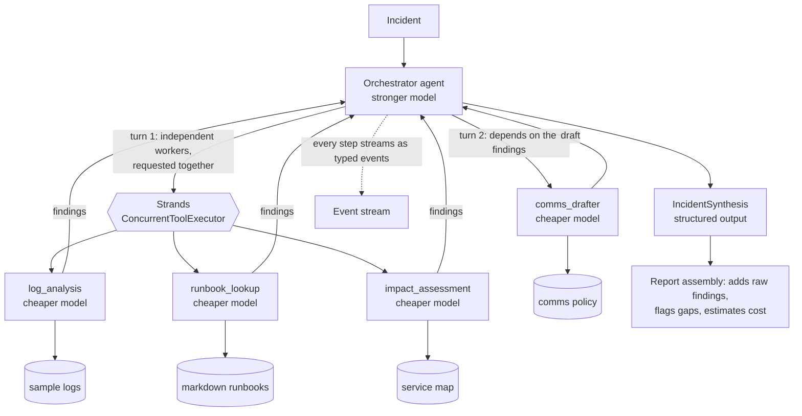

# Orchestrator-workers incident response with Strands Agents

A public proof of concept showing **one framework** ([Strands Agents](https://strandsagents.com))
implementing **one agentic pattern** (orchestrator-workers) for **one enterprise job**: IT operations
incident response.

An incident goes to an orchestrator agent on a stronger model. It decides, at run time, which
specialist workers on a cheaper model to call. They run in parallel where they are independent, and
the orchestrator turns their findings into an incident summary, probable cause, recommended actions
and a stakeholder message.

> **Status.** This is the agent core. The API and UI, then the CDK infrastructure and deployment
> guide, follow in later pull requests. Everything has been tested offline with a fake LLM and a
> stubbed Bedrock client. **It has not yet been run against live Bedrock**, because no AWS credentials
> were available when it was built.

## Try it

You need [uv](https://docs.astral.sh/uv/) and nothing else: no AWS account.

```bash
make install
make sample                               # the full team on a sev1 outage
make sample SAMPLE=batch-disk-full        # the same code picks a smaller team
uv run python -m incident_agent --list    # all the samples
uv run python -m incident_agent --sample batch-disk-full --simulate-failure log_analysis
```

The fake LLM is keyword rules and templates, so its prose is not impressive and its "judgement" is
not judgement. What it shows is everything around the model: the Strands event loop, parallel
execution, and real tool calls over the bundled sample data all run for real.

For real models, enable access to the models in your account, then:

```bash
LLM_MODE=bedrock AWS_REGION=us-east-1 make sample
```

| Variable | Default | Purpose |
| --- | --- | --- |
| `LLM_MODE` | `fake` | `fake` or `bedrock` |
| `BEDROCK_MODEL_ID` | `us.anthropic.claude-opus-5-5` | Orchestrator model |
| `BEDROCK_WORKER_MODEL_ID` | `us.anthropic.claude-haiku-5-5` | Worker model |
| `AWS_REGION` | `us-east-1` | Region for Bedrock calls |

See [`.env.example`](.env.example) for the rest. The defaults are geo inference profile ids from the
[Bedrock model cards](https://docs.aws.amazon.com/bedrock/latest/userguide/model-cards.html). If you
use `aws login` credentials, botocore also needs `botocore[crt]`.

## The pattern

In **orchestrator-workers**, a central LLM breaks down a task it cannot plan in advance, hands the
pieces to workers, and combines what comes back. The defining feature is that **the subtasks are
decided at run time, from the input**.

**Use it when** the work splits into specialisms, which ones you need depends on the input, and some
can run independently. Incident response fits: a full disk does not need a customer announcement, and
planned maintenance does not need log forensics.

**Do not use it when:**

- The steps are the same every time. A pipeline is cheaper, faster and easier to test.
- A single agent with several tools would do. Workers earn their keep through isolated context and a
  cheaper model, and if you do not need those, they are only extra latency.
- Workers must negotiate with each other. Here they only ever talk to the orchestrator.
- Being wrong is expensive and hard to catch. Here the LLM chooses the work, so runs vary. This
  project only ever recommends actions to people, and nothing it does changes a system.



## How Strands expresses it

**This project uses agents-as-tools**, because that is the Strands primitive with the same shape as
the pattern:

```python
# src/incident_agent/workers.py: a worker is an agent, wrapped as a tool
Agent(name=spec.name, model=worker_model, system_prompt=..., tools=[...]).as_tool(
    name=..., description=...
)

# src/incident_agent/orchestrator.py: the orchestrator is an agent whose tools are the workers
Agent(
    model=orchestrator_model,
    tools=[record_plan, *worker_tools],
    tool_executor=ConcurrentToolExecutor(),
    structured_output_model=IncidentSynthesis,
)
```

| Strands option | Who decides what runs | Parallel? | Results return to a coordinator? | Fit |
| --- | --- | --- | --- | --- |
| **Agents-as-tools** | One LLM, at run time | Yes: tool calls from one response run together | Yes, as tool results | **The pattern, directly** |
| Swarm | Each agent hands off to the next | No: one active agent at a time | No central coordinator | Collaboration without an orchestrator |
| Graph | You, at design time, as edges | Yes, along the edges you drew | Only into nodes you wired | Known workflows |

A graph could imitate this with a router node and conditional edges, but then the set of possible
paths is fixed in code, which is exactly what this pattern avoids. A swarm has no one to synthesise.

Things worth noticing in the code:

- **The LLM expresses parallelism by asking for several things at once.** Tool calls in one response
  run concurrently, and calls in a later response naturally wait. That is how `comms_drafter` gets to
  run after the findings it depends on, with no dependency graph anywhere in the code.
- **Workers are isolated.** A worker sees only the brief the orchestrator wrote and the orchestrator
  sees only the final answer, so its context stays small.
- **Streaming needs no extra plumbing.** Strands surfaces each sub-agent's events through the parent's
  stream. [`translator.py`](src/incident_agent/translator.py) is the one module that knows those
  shapes, and it turns them into the typed events in
  [`schemas.py`](src/incident_agent/schemas.py).
- **Failure handling is mostly the framework's.** A crashing worker becomes an error tool result, so
  the orchestrator can retry or carry on without it.

Some decisions were forced by how the current models and Strands really behave, and are easy to get
wrong:

- **The plan is a tool call, not text.** Opus 5.5 can return text written between tool calls as hidden
  thinking blocks, so a plan written as prose may never reach you. Tool inputs always do. That is why
  `record_plan` exists.
- **A worker's finish is read from its own stream.** Strands only delivers tool results once the whole
  parallel batch is done, so waiting for them would show every worker finishing with the slowest.
- **Refusals are checked explicitly.** A worker the model declines to answer still looks like a
  successful tool call, so its stop reason is inspected.
- **Turn and token limits are shared.** Strands counts them across the whole request, workers
  included, so they are sized for the team.
- **Forced `tool_choice` is unavailable on Opus 5.5.** Strands' structured output falls back when
  Bedrock rejects it, and a test confirms this against a stubbed rejection.

## Trust, but verify the synthesis

The LLM writes the conclusions, but it does not get to mark its own homework.
[`report.py`](src/incident_agent/report.py) adds each worker's raw output to the report directly from
the run, flags any worker the synthesis failed to account for, and marks the report `degraded` if
anything is missing. If the orchestrator fails after workers have finished, you still get their
findings.

Text from incidents, logs and runbooks is untrusted: it could contain instructions aimed at the model.
It is delimited and described as data in the prompts, and tools are read-only with names checked
against the bundled data. That reduces the risk of prompt injection but does not eliminate it, which
is another reason this system only recommends.

## Tests

`make check` runs everything CI runs, offline, with no credentials. The tests drive the real Strands
agents and event loop behind a scripted model.

| Requirement | How it is tested |
| --- | --- |
| Different incidents get different workers | Scripted decisions per incident, plus each sample through the rule-based fake. Unchosen workers' models must never be called |
| Workers really run concurrently | An `asyncio.Barrier` every worker must reach while the others are mid-request. Sequential execution deadlocks, and a companion test proves that it does |
| A failing worker degrades gracefully | Crashes, refusals, empty answers, duplicates, deadlines and a failing orchestrator, each asserting a usable report or a clear failure |
| Synthesis includes every worker | The final model call must contain each full output, the report must carry each verbatim, and a synthesis that drops a worker must be flagged |
| Real provider behaviour | The real `BedrockModel` against a stubbed AWS client: model routing per tier, request shape, recovery from a forced `tool_choice` rejection |

## Licence

[MIT](LICENSE)
